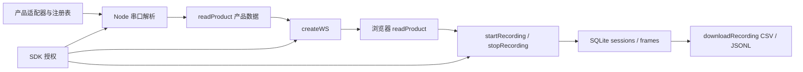

# Shroom SDK 架构

最后更新于：2026-10-30

## 1. 项目概述

本仓库维护独立的 `shroom-sdk`：读取传感器数据、按需创建 WebSocket 服务、采集到 SQLite、停止采集并导出 CSV / JSONL。快速入口只导出五个函数，产品协议和点位映射由内部适配器管理。Node.js、浏览器和 Python 共享版本号，但语言能力按各自文档定义。

官网与文档展示位于独立的 `shroomSDKWEB` 仓库，通过 `sdk/` Git 子模块固定本仓库的具体提交。SDK 的安装、测试、构建和发布均不依赖官网。官网构建使用固定提交中的文档、示例生成函数及下载包，不自动跟随 SDK 主分支。

仓库原来的 `shroom-backend-sdk@0.2.0` 已由当前五步 SDK 替换，旧实现保留在 `legacy-backend-sdk-0.2.0` 标签及 Git 历史。旧接口、组件、数据库不能被视作当前包的兼容能力；具体差异见 [MIGRATION.md](MIGRATION.md)。本文末尾保留旧项目进度与更新记录，作为历史记录。

## 2. 技术栈

| 分类 | 技术与边界 |
| --- | --- |
| JavaScript | ES Module；Node.js 运行时要求见根 `package.json`；浏览器使用 Web Serial 或 WebSocket |
| Python | Python 3.10+，同步迭代与通用矩阵接口；不提供 JS 五步 WS/SQLite 服务 |
| 串口 | Node `serialport`、浏览器 Web Serial、Python `pyserial` |
| 采集 | `better-sqlite3`，`sessions / frames` 表，批量事务与分页导出 |
| 通信 | `ws`，同端口 HTTP 下载；应用后端通过独立 `BackendSdkClient` 访问 |
| 依赖与类型 | npm 锁文件、Python 测试锁文件、TypeScript 声明与类型测试 |
| 验证与发布 | Node 内置测试、Python unittest、确定性 ZIP、SHA256；GitHub Actions |
| 维护环境 | Node.js 22.22.0 / npm 10.9.4；Python 测试 3.11+，CI 3.12 |

## 3. 目录结构

```text
shroomSDK/
├─ package.json              SDK 版本唯一来源、公开导出与维护命令
├─ package-lock.json         JavaScript 锁定依赖
├─ quick-flow.js / .d.ts      五个快速函数入口与类型
├─ flow/                     连接、采集会话和生命周期编排
├─ core/
│  ├─ products/              产品适配器、注册表、字段校验
│  ├─ framer.js / frame.js   拆帧和通用矩阵
│  └─ license.js             SDK 产品授权与运行期权限检查
├─ node/                     Node 串口、WS/HTTP 服务、SQLite 录制
├─ web/                      浏览器串口、WS 控制、二维显示及演示
├─ backend/                  已运行主项目后端的 HTTP/WS 客户端
├─ python/
│  ├─ src/shroom_sdk/        Python 运行源码
│  ├─ tests/                Python 与跨语言测试
│  └─ requirements-test.lock
├─ examples/                 五步调用生成器和演示
├─ docs/                     SDK 接入与基础 API 文档，供官网读取
├─ tests/                    JS、协议、授权、采集和类型测试
├─ scripts/                  版本、构建、打包、制品校验及安装验证
├─ .github/workflows/        跨平台检查和版本标签发布
├─ dist/                     生成的兼容 ZIP，不跟踪到 Git
│  └─ releases/<version>/    版本 ZIP、清单、校验值、发布说明
├─ CHANGELOG.md              当前包版本更新记录
├─ MIGRATION.md              原仓库实现的迁移边界
└─ SDK-RELEASING.md           维护与发布流程
```

SDK 源文件直接位于仓库根目录下，没有第二层 `sdk/`。客户 ZIP 采用交付白名单，排除测试、构建脚本、依赖目录、开发缓存及用户采集记录；源码仓库保留这些开发工具。网页 bundle 和内联示例由源码构建，修改模块后应重新生成。

## 4. 核心模块与数据流



五函数复用基础 API：`readProduct` 调用 Node `connectProduct` 或浏览器 `connectStream`；`createWS` 调用 `serveDevice`；采集和下载委托已有连接或服务方法。返回对象与 `stream` 保存当前会话，成功开始新采集时清除旧下载 ID。

产品代码集中在 `core/products/`。增加产品通过适配器与注册表扩展协议、映射和 WS 字段校验，不改五个函数签名。产品扩展测试会在临时副本注册测试产品，验证串口、五步调用、录制、导出和浏览器 bundle 的一致性。

录制使用 SQLite 事务批量写入；停止与关闭等待待写队列落库，导出按页读取。记录目录有独占所有权；异常退出记录可恢复为中断状态。兼容读取旧 JSONL 文件，不兼容原 `shroom-backend-sdk` 的 `captures / frames` 数据库。

授权区分 SDK 与上位机产品密钥，检查有效期、电脑名额和功能权限，不按传感器型号限制。JS/Python 均提供结构化错误；连接阶段的拒绝由调用方捕获，连接后的运行错误通过订阅反馈。模拟数据源用于无硬件验证。

## 5. 快速服务端点

`createWS` 默认在 `127.0.0.1:19999` 创建本机服务，浏览器经同一服务获取数据和下载。跨主机使用必须显式指定允许的网页来源。

| 协议 | 路径或消息 | 用途 |
| --- | --- | --- |
| HTTP GET | `/health` | 服务、产品与采集状态 |
| HTTP GET | `/recordings/<id>.csv` | 导出已停止的采集记录 |
| HTTP GET | `/recordings/<id>.jsonl` | 导出完整帧记录 |
| WebSocket | `/` 或 `/ws` | 实时帧、状态与控制响应 |
| WS JSON | `recording.start / stop / status / list` | 带 `requestId` 的采集控制 |

这些端点属于快速本机服务；`BackendSdkClient` 访问的主项目 HTTP/WS 协议另见 [BACKEND.md](BACKEND.md)。

## 6. 版本、发布与官网集成

根 `package.json.version` 同步到 `core/version.js`、Python 包元数据和 `_version.py`。发布检查包含原生依赖加载、JS/发布工具/Python 测试、类型检查及客户 ZIP 独立安装验证。SDK 不运行官网的页面或服务测试。

构建输出 `dist/shroom-sdk.zip`、`dist/shroom-sdk-node.zip`、`dist/shroom-sdk-python.zip`。正式版本目录有六个文件：三个带版本 ZIP、`manifest.json`、`SHA256SUMS`、`RELEASE-NOTES.md`。清单记录真实 Git 提交与脏状态；相同版本不允许被不同内容或不同来源覆盖。

GitHub Actions 使用锁定工具版本与固定 Action 提交。普通提交运行检查；`sdk-vX.Y.Z` 标签触发 Windows/macOS/Linux 检查，Linux 打包并保存附件，具有写权限的后续任务重新验证附件再创建 Release 草稿。同名 Release 不覆盖。工作流不自动发布 npm、PyPI 或部署官网。

官网只在明确更新子模块指针后采用新的 SDK 提交；文档、产品示例、版本展示及兼容 ZIP 下载都来自该固定来源。SDK 发布和官网部署分别执行。

## 7. 环境变量

以下授权变量由示例显式调用 `activateLicenseFromEnv()` 时读取，仅导入 SDK 不会自动激活。

| 变量 | 用途 |
| --- | --- |
| `SHROOM_LICENSE_KEY` | SDK 密钥字符串，优先于文件 |
| `SHROOM_LICENSE_FILE` | SDK 密钥文件路径 |
| `SHROOM_DEVICE_ID` | 覆盖本机稳定安装标识 |
| `SHROOM_LICENSE_MODE` | `online` 或 `offline` |
| `SHROOM_LICENSE_SERVER` | 授权服务地址 |
| `SHROOM_LICENSE_PUBLIC_KEY_FILE` | 离线验证公钥文件 |
| `SDK_PYTHON` | 维护测试使用的 Python 解释器 |
| `GITHUB_REF / GITHUB_SHA` | CI 发布的标签和提交校验来源 |

## 8. 项目进度

旧实现的累积完成记录保留在下方历史区，不代表当前包仍包含那些接口。

| 完成日期 | 完成的功能/工作 | 说明 |
| --- | --- | --- |
| 2026-10-30 | 独立五步 SDK 仓库 | 当前 Node/Web/Python SDK、适配器、授权、SQLite、文档与测试迁入根目录；官网固定提交引用 |
| 2026-10-30 | 独立构建与发布 | 版本、依赖锁、类型校验、客户 ZIP 验证、跨平台 CI 与 Release 草稿均在 SDK 仓库完成 |

## 9. 更新日志

| 日期 | 变更类型 | 描述 |
| --- | --- | --- |
| 2026-10-30 | 优化重构 | 按决定直接替换原主线 SDK，保留旧标签与历史；建立五步 SDK 和官网的独立仓库边界 |
| 2026-10-30 | 文档更新 | 更新根目录安装与发布说明，明确包身份、旧接口和数据库的迁移边界 |

## 10. 原 SDK 历史记录

以下记录原样保留自替换前的架构文档，对应 `shroom-backend-sdk` 与旧 `src/`、`UI/` 布局。当前代码以本文第 1–9 节及当前 API 文档为准。

## 更新日志

| 日期 | 变更类型 | 说明 |
| :--- | :--- | :--- |
| 2026-08-11 | 新增功能 | 接入 `UI/qxui` React 组件，移除组件中的项目别名依赖，并新增 UI 文档展示页 |
| 2026-08-11 | 新增功能 | 接入 `UI/shroomui` 基础组件库，补全入口导出、SCSS 依赖说明和组件文档 |
| 2026-08-11 | 文档更新 | 将 VitePress 侧边栏拆为开始、后端与串口、UI 组件、API Reference 四个二级分组，并扩展 UI 组件展示页 |
| 2026-08-11 | 文档更新 | 将 17 个 UI 组件拆为独立页面，新增 Vue-to-React 实时示例桥接，并提供播放、滑块、抽屉、弹窗等可交互演示 |
| 2026-08-11 | 修复缺陷 | 修复 `qxui` 独立构建时的 React runtime、styled-components v6 导入和原项目根字号依赖问题，替换遗留 iconfont 图标 |
| 2026-08-11 | 新增功能 | 将 `TerrainMapPage` 提取为 `UI/render` 矩阵渲染 SDK，新增 Three.js 地形、矩阵预览、插值、平滑、配色和视角控制 |
| 2026-08-11 | 修复缺陷 | `TerrainMap` 网格恢复源项目的基础矩阵横纵线逻辑，只在有效压力区域生成线段，移除插值三角面产生的密集对角线 |
| 2026-08-11 | 发布优化 | 排除 `UI` 子项目中的 `node_modules`、`dist` 和 Vite 缓存，避免本地安装包递归包含开发依赖和文档构建产物 |
| 2026-08-11 | 类型与健壮性 | 为 `UI/render` 增加公开类型入口，并为网格算法的无效数值输入提供有限默认值 |
| 2026-08-11 | 新增功能 | 将 `numMatrix`、`pointGrid`、`handPoints`、`webglHeatmap`、`blobHeatmap` 整合到 `UI/frontend/renderers`，提供注册表和兼容导出 |
| 2026-08-11 | 文档更新 | 为五套矩阵渲染器新增独立中文页面、真实动态矩阵示例、控制项和二级导航 |
| 2026-08-11 | 修复缺陷 | 将点阵和手部渲染器迁移到 Three.js 当前 `outputColorSpace` API，消除旧颜色编码接口警告 |
| 2026-08-11 | 发布优化 | 矩阵渲染器改为跟随宿主容器尺寸，手模改为显式可选资源，并将 Three.js 最低版本收紧到 r152 |
| 2026-08-11 | 发布优化 | 根 npm 包仅发布运行源文件、示例和入口文档，不再包含 VitePress 站点与实施计划 |
| 2026-08-12 | 文档交互 | 五个矩阵渲染示例新增 `params` JSON 编辑器，输入帧统一为从 1 开始的连续递增数组 |
| 2026-08-12 | 文档交互 | `TerrainMap` 接入共享参数编辑器，六个矩阵组件示例补全常用公开参数并同步参数与演示输入 |
| 2026-08-14 | 修复缺陷 | 缩短矩阵示例参数区和渲染舞台，修复数字矩阵浮层、固定画布裁切及移动端非正方形问题 |
| 2026-08-14 | 文档交互 | 矩阵参数编辑器默认折叠，PointGrid 新增点高度和色阶上限参数及实时调节控件 |
| 2026-08-14 | 修复缺陷 | 统一 NumMatrix 与 PointGrid 的常规矩阵 row-major 方向，移除默认旋转和行列转置，并提供 `filterMin: 0` 原值展示配置 |
| 2026-08-20 | 新增功能 | 五套矩阵渲染器新增声明式 `frame` / `backFrame` prop，命令式 ref 通路保持不变 |
| 2026-08-20 | 文档更新 | `API_REFERENCE` 重写为参数级参考，补齐构造 options、方法签名、返回结构和已知限制 |
| 2026-08-20 | 发布优化 | 根包新增 `exports` 映射，前端短路径由 7 段降为 2 段，旧深路径全量保留兼容 |
| 2026-08-20 | 文档更新 | 补打包器配置（Vite / webpack）、peer deps 分组安装、五个渲染器参数表与静默钳制规则 |
| 2026-08-21 | 新增功能 | `PointGridRenderer` 支持按空间位置渲染：稀疏实测坐标表自动插值，Z 作为点的基础高度 |
| 2026-08-25 | 修复缺陷 | 补回 `jqbed` / `handSinglePoint` 内置线序，11 个 profile 全部可解析（此前 3 个首帧必崩） |
| 2026-08-25 | 修复缺陷 | `handleRawFrame` 分阶段捕获异常，`error` 无监听者时降级提示，多通道打开失败回滚已开端口 |
| 2026-08-25 | 测试补齐 | `src/` 从零测试到 69 项，覆盖解析、线序、清零、存储、回放与会话容错 |
| 2026-08-25 | 手套 SDK | 明确四个产品 Profile，补齐分包/整包组帧、压力与 IMU 语义、左右手 Mapping 和 `connectGlove()` |
| 2026-08-25 | 手套校验 | 新增生产协议形态 fixture，覆盖左右交错组帧、缺首包、长度校验、IMU float32LE 和 256→147/195→1024 Mapping |
| 2026-08-25 | 手套点位表 | 录入左右手结构化 Mapping，扁平线序改为自动生成并增加范围、重复点和布局校验 |
| 2026-08-27 | 采集 SDK | 参考 `E:\shroom1` 抽取按通道限频、全帧模式、批量事务、停止 flush、磁盘保护和采集错误状态 |
| 2026-08-27 | 串口 SDK | 参考 `E:\shroom` 补齐 `SerialManager`、自动波特率、稳定重试、连接锁、断流状态、重扫、写串口和统一错误码 |
| 2026-08-28 | 后端能力闭环 | 补齐存储分页/筛选/删除、可控回放、CSV 算法列和简单算法通道，六项能力使用统一标准帧 |
| 2026-08-28 | 文档更新 | 新增 `Backend Capabilities` 页面和串口、采集、存储、回放、CSV、算法通道二级导航 |

## 项目进度

| 日期 | 完成项 | 说明 |
| :--- | :--- | :--- |
| 2026-07-08 | 后端 SDK 根入口 | 提供 `BackendSdkClient`、`ShroomSensorSDK`、协议、采集、回放、导出等能力 |
| 2026-07-08 | 本地串口 demo | 提供真实串口和 mock 模式验证链路 |
| 2026-07-08 | VitePress 文档 | 提供使用文档、API Reference、后端链路和串口链路 |
| 2026-08-11 | 动态报告 UI 组件 | 新增动态报告、回放控制、指标展示和热力图占位展示组件 |
| 2026-08-11 | 基础 UI 组件库 | 新增 `AsyncState`、`ChartPanel`、`Drawer`、`ExportDialog`、`MetricValue`、`Select`、`SettingControlRow`、`ToolbarAction` 等组件入口 |
| 2026-08-11 | UI 文档分组展示 | UI 文档按 `qxui` 和 `shroomui` 展示全部组件，并在侧边栏提供组件级锚点导航 |
| 2026-08-11 | UI 独立组件页 | 为全部 17 个 UI 组件提供独立中文页面、实时交互示例、最小用法和 Props/行为说明 |
| 2026-08-11 | 矩阵渲染 SDK | 新增 `TerrainMap`、矩阵归一化、高斯平滑、双三次插值和配色算法导出，并提供独立交互文档页 |
| 2026-08-11 | 地形网格一致性 | 新增可测试的 `buildTerrainWireSegments`，网格密度、连接方向和有效值阈值与原 `TerrainMapPage` 保持一致 |
| 2026-08-11 | 五套矩阵渲染器 SDK | 完成前端子包边界、core/react 分层、按需注册、旧路径兼容和 pnpm 发布文件约束 |
| 2026-08-11 | 矩阵渲染器交互文档 | 在矩阵渲染分栏下新增五个组件级页面，可直接查看动态效果并操作后端、视角和色阶 |
| 2026-08-11 | 外部宿主适配 | 五套矩阵渲染器完成宿主尺寸约束、可选模型加载和发布依赖边界核对 |
| 2026-08-12 | 渲染参数在线调试 | 文档页支持修改、应用和重置组件 `params`，并根据矩阵尺寸重建递增演示帧 |
| 2026-08-12 | TerrainMap 在线调参 | 文档页支持在线修改组件 props 和 `TerrainMapOptions`，输入数组随 `rows * columns` 自动重建 |
| 2026-08-14 | 渲染文档响应式适配 | 六个矩阵渲染页在桌面和移动视口中完整展示，数字矩阵保持正方形且不再裁切 |
| 2026-08-14 | PointGrid 显示调参 | `heightScale` 和 `colorMax` 可通过 SDK 参数或文档滑块控制，并兼容旧项目默认值 |
| 2026-08-14 | 矩阵方向一致性 | 常规矩阵输入按 `data[row * cols + col]` 原位置展示，NumMatrix 与 PointGrid 不再隐式改变方向 |
| 2026-08-14 | 全渲染方向与热图色阶 | 修正 PointGrid 上下方向和 BlobHeatmap 非方阵转置，关闭 WebglHeatmap 默认镜像，并按 1..1024 示例范围校准两种热力图色阶与点半径 |
| 2026-08-20 | 声明式帧入口 | 五个渲染器接入 `frame` prop，接入代码从「建 ref + useEffect + `sitData({ wsPointData })`」降为一个 prop |
| 2026-08-20 | 后端参数参考 | `API_REFERENCE` 覆盖全部根导出、构造 options、方法参数与返回结构，并标注存储、导出、实时通道的已知限制 |
| 2026-08-20 | 前端接入面收口 | 根包 `exports` 打通短路径与类型入口，`tests/package-exports.test.mjs` 锁死全部已文档化旧路径 |
| 2026-08-20 | 渲染参数文档补齐 | numMatrix 由 6 项补到 60 余项（含 `canvas2d` / `webgl` 嵌套对象），handPoints 由 4 项补到 19 项，五页均写明取值范围钳制 |
| 2026-08-21 | 空间位置点阵 | `core/coordinateGrid.js` 提供稀疏坐标表的插值与补边，点阵渲染器新增 `sparsePoints`，曲面传感器可按实测点位与自身起伏成形 |
| 2026-08-25 | 数据链路可用性 | 内置线序补回、帧处理全程容错、端口回滚；客户第一步「数据联通」不再因单帧异常终止进程 |
| 2026-08-25 | 手套最小链路 | `connectGlove()` 完成查口/连接/组帧/解析/左右手 Mapping，帧可直接送入 32×32 渲染器或采集链路 |
| 2026-08-25 | 左右手 Mapping | 五指、指腹、手掌点位进入 SDK 单一数据源，外部项目可通过 `GLOVE_HAND_MAPPING` 读取原始分组 |
| 2026-08-27 | 稳定采集链路 | `CaptureController` 统一管理采集频率、批次和统计，SQLite/内存 Store 对齐 `insertFrames`，会话关闭不再遗留未落库帧 |
| 2026-08-27 | 串口管理闭环 | 同时支持手动与一键连接，聚合所有串口的最新数据、在线/断流状态，并打通写入、重连、重扫和错误处理 |
| 2026-08-28 | 后端六项能力 | 串口、采集、存储、回放、CSV 和简单算法通道均提供根入口、统一数据流、测试与本地网页文档 |
